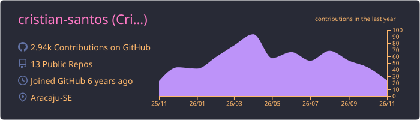
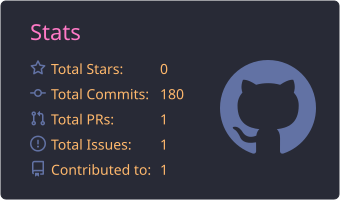
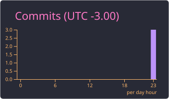
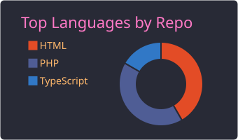
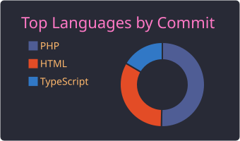

<h1 align="center">Olá, eu sou o Cristian 👋</h1>

  Desenvolvedor apaixonado por tecnologia e por aprender coisas novas.

---

## 🚀 Sobre mim

Sou o Cristian, desenvolvedor de software apaixonado por resolver problemas e construir soluções que fazem diferença no dia a dia.

- 💼 Atuo profissionalmente com desenvolvimento de software
- 🌱 Sempre aprendendo algo novo e buscando evoluir como dev
- 🧩 Gosto de código limpo, boas práticas e desafios técnicos
- 🤝 Aberto a trocar ideias sobre tecnologia e projetos interessantes
---

## 📊 Estatísticas no GitHub

  

  
  

  
  

